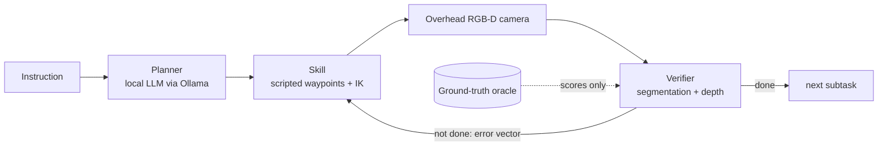

# Language-to-Action Robot Agent

A manipulation agent that **checks its own work from camera pixels and retries from the error it measured**, with the benefit of that check measured in an ablation, not asserted.

Natural language goes in. A local LLM plans, a scripted controller acts in MuJoCo, and a verifier that sees only an overhead RGB-D camera decides whether the block really ended up where it should. Simulator ground truth is read only by the scorer.

> **Replay viewer:** [`web/`](web) is a static site (recorded rollouts, ablation tables, method). Run it locally with `python -m http.server 8765 --directory web`; `vercel.json` deploys the same folder.

## Result

Success = simulator ground truth at the end of the episode. 30 seeds x 3 tasks = 90 paired episodes per cell, attempt budget 3, 95% Wilson intervals. Full tables, per-task numbers and the paired tests are in [BENCHMARKS.md](BENCHMARKS.md).

| Fault profile | No verifier | Verifier, blind retry | Verifier, corrected retry |
|---|---|---|---|
| nominal (no faults) | 100% | 100% | 100% |
| noisy (random grasp/release error) | 34% [25-45] | **66%** [55-75] | 52% [42-62] |
| biased (constant 5.4 cm release error) | 33% [24-44] | 33% [24-44] | **98%** [92-99] |
| slippery (half the grasps drop the block) | 52% [42-62] | **78%** [68-85] | 72% [62-80] |

What this says, including the parts that do not flatter the method:

- **Verifying from pixels pays whenever execution can fail silently.** Without a verifier the robot reported success on 59 of 90 noisy and 60 of 90 biased episodes that ground truth scored as failures. The camera verifier agreed with ground truth on 2314 of 2318 attempt-level verdicts (3 false accepts, 1 false reject).
- **Using the measured error helps when the error is systematic.** Under the constant release bias, corrected retry goes from 33% to 98% (58 episodes only it solved, 0 the other way, p < 1e-17); blind retry just repeats the mistake.
- **It hurts when the error is random.** Under random noise the corrected retry chases noise and does worse than blind retry (52% vs 66%, p = 0.008). Damping the correction (alpha 0.4) recovers part of the gap (58%) and costs nothing on the biased profile (99%). After a mid-carry slip the "correction" is not a calibration error at all and is slightly harmful (72% vs 78%, not significant at p = 0.06).
- The camera verifier is as good as an oracle verifier here (52% vs 54% noisy, 98% vs 97% biased; differences not significant).
- **Replicated on a standard benchmark.** ManiSkill3 `PickCube-v1` (official success metric, Docker, 30 seeds): under the constant release bias, no verifier 0/30 and blind retry 0/30, corrected retry 25/30 (p = 6e-8). Under random noise verification moved 27% to 40% (not significant at n = 30), and with no faults the verifier arms lose 2-3 of 30 to occlusion of the held cube. Details in [BENCHMARKS.md](BENCHMARKS.md).
- Faults are injected on purpose; their sizes are my choice, so the size of any gain depends on them. See [Limits](#limits).

## How it works



| Piece | Where | Notes |
|---|---|---|
| Planner | [`agent/planner.py`](agent/planner.py) | Ollama (default `qwen3-vl:4b-instruct`), labelled regex fallback when no model answers (no cloud dependency) |
| Skills | [`agent/executor.py`](agent/executor.py), [`env/so101_env.py`](env/so101_env.py) | Waypoint controller + damped-least-squares IK with restarts; kinematic grasp assist during carry |
| Perception | [`perception/`](perception) | Colour segmentation + depth (1-2 mm in the clean scene); optional Qwen3-VL point grounding |
| Verifier / retry | [`agent/verifier.py`](agent/verifier.py), [`agent/retry_controller.py`](agent/retry_controller.py) | Camera, oracle or none; blind or error-corrected retry |
| Faults | [`env/faults.py`](env/faults.py) | Seeded so all arms see identical faults on attempt 1 |
| Benchmark | [`bench/`](bench) | Seeded tasks, ablation grid, statistics, report, replay recorder |
| Typed tools | [`tools/`](tools) | JSON-schema skills and a dependency-free stdio MCP server |
| Viewer | [`web/`](web) | Static replays + results |

## Quickstart

```bash
python -m venv .venv && source .venv/bin/activate      # Windows: .venv\Scripts\activate
pip install -e ".[dashboard,dev]"
pytest                                                  # fast + physics tests
```

Run an instruction (needs a local model: `ollama pull qwen3-vl:4b-instruct`; without one a labelled regex parser plans):

```bash
python run_agent.py "put the green block in the bin, then stack red on yellow"
```

Reproduce the ablation, tables and replays (minutes on a laptop CPU):

```bash
python -m bench.run --episodes 30 --workers 8 --out results/ablation.json
python -m bench.report results/ablation.json --md results/ablation.md --json web/data/results.json
python -m bench.record --results results/ablation.json --out web/data
python -m http.server 8765 --directory web
```

Other entry points:

```bash
python -m dashboard.app                 # Gradio UI: instruction, fault profile, live attempts, verifier's view
python -m tools.mcp_server              # MCP server over stdio (typed robot tools)
python -m bench.planner_eval --models heuristic qwen3-vl:4b-instruct
python -m bench.grounding --models qwen3-vl:4b-instruct  # segmentation vs VLM localisation error
docker build -f docker/maniskill/Dockerfile -t robot-agent-maniskill .   # then: docker run --rm -v "$PWD/results:/work/results" robot-agent-maniskill maniskill_bench.run --episodes 30
docker build -t robot-agent . && docker run --rm robot-agent bench.run --episodes 5 --workers 2 --out results/smoke.json
```

## Limits

- **Simulation only**: a small 6-DOF arm (not the real SO-101 geometry) in MuJoCo with four cubes and a bin.
- **Scripted skills, not a learned policy.** The carry uses a kinematic grasp assist; arm motion, collisions, the drop and the resting pose are physics. This is a study of verification, not manipulation skill, and it is not comparable to VLA numbers.
- **Injected faults.** A perfect scripted arm has nothing for a verifier to catch. Profiles and sizes are in [`env/faults.py`](env/faults.py).
- **Perception is easy by design**: fixed overhead camera, flat lighting, saturated colours, Gaussian sensor noise. Between looks the arm is teleported out of view.
- **Verifier and scorer share one geometric definition of success**, so their agreement measures perception, not task definition.
- Not done: LeRobot dataset export; the ROS 2 bridge is untested. See [docs/DECISIONS.md](docs/DECISIONS.md).

## Docs

[BENCHMARKS.md](BENCHMARKS.md) (method, hardware, every number) · [docs/DECISIONS.md](docs/DECISIONS.md) · [docs/ROADMAP.md](docs/ROADMAP.md) · [docs/INTERVIEW_PACK.md](docs/INTERVIEW_PACK.md)

MIT licensed.
